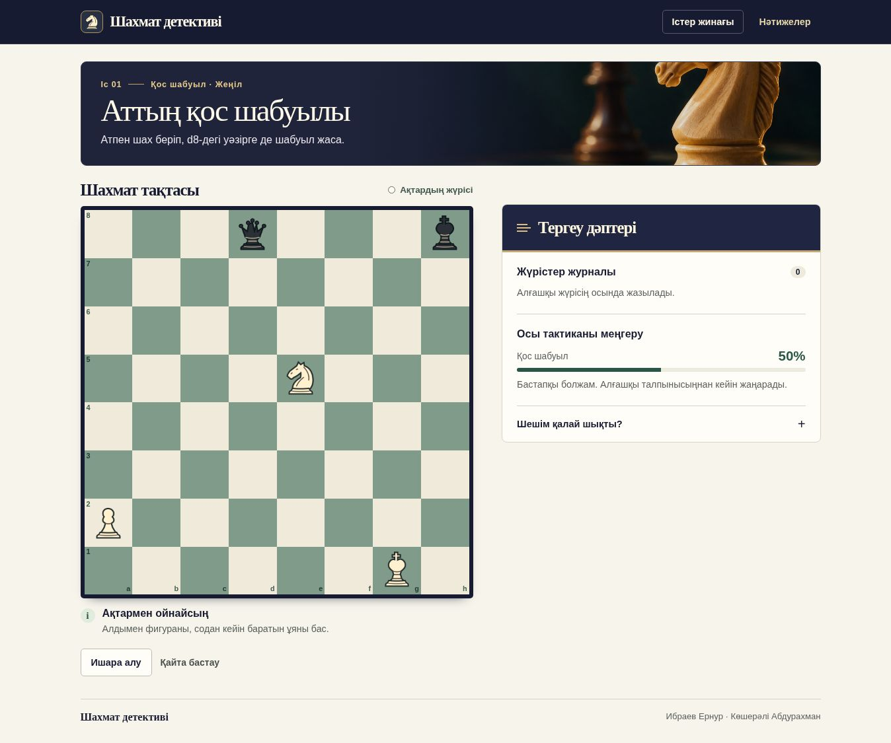
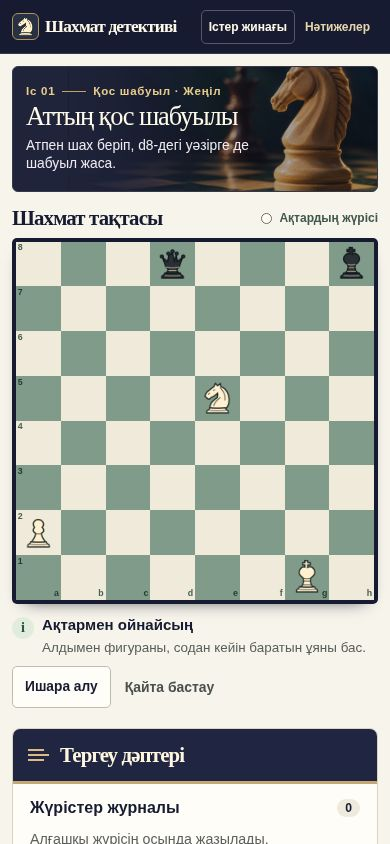

# Шахмат детективі ♞

**Ибраев Ернур, Көшерәлі Абдурахман және Мұратұлы Диас · QAIRU · AI Fundamentals Final Project 2026**

Ақ атпен бір жүрісте қара корольге де, уәзірге де шабуыл жасауға бола ма? Тақтадан жүрісті тап, қарсыластың жауабын көр де, уәзірді өзің ал. Детектив режимінде үш деңгейге бөлінген тоғыз есеп бар. Екінші режимде стандартты тақтадан ақтармен толық партия ойнайсың. Соңында өзіңнің жүрісің мен сол сәтте мүмкін болған басқа жүрісті тақтадан салыстырасың.

## Жылдам бастау

Компьютерден, Android телефонынан немесе iPhone-нан браузерді ашып, [жарияланған ойынды іске қос](https://ibraevernur7-lab.github.io/chess-detective-final/).

1. ZIP мұрағатын толық шығарып ал. Компьютерде негізгі бумадағы [index.html](index.html) файлын Chrome, Edge, Firefox немесе Safari браузерінде аш. Ойынның тікелей кіреберісі — [web/index.html](web/index.html).
2. Басты беттен «Шахмат детективі» режимін таңда. «Аттың қос шабуылы» есебінде ақ атты **e5** ұясынан таңда. **f7** ұясын бас. Қара король шахтан шыққан соң, **f7 → d8** ойнап, уәзірді ал. Телефонда да фигура мен баратын ұяны кезекпен түрт.
3. «Істер жинағы» арқылы басқа тақырып пен деңгейді таңда. «Нәтижелер» бөлімінде тактикалардың бағасын, келесі істі және ұсынысқа әсер ететін мақсатты көр.
4. Толық партияны ойнау үшін режим таңдау бетіне оралып, **«AI-ға қарсы партия»** нұсқасын таңда. Ақ фигураны түрт, баратын ұяны таңда, қараның жауабын күт. Мат, тең ойын немесе берілгеніңді растаудан кейін ақ жүрістердің бірін ашып, өз нұсқаң мен ұсынылған баламаны салыстыр.
5. Телефонда жоғарыдағы ойын сілтемесін аш. Қорғау күні интернет үзіліп қалса, компьютердегі жергілікті нұсқаны қолдан.

Ойын браузерде орындалады. Орнату, сервер, камера немесе сыртқы AI кілті қажет емес. Нәтижелер ағымдағы браузердің жергілікті жадында сақталады. Телефон мен компьютер өз статистикасын бөлек жүргізеді.

## Үш AI тақырыбы

| Силлабус | Код | Ойын кезінде |
| --- | --- | --- |
| 4-апта · қарсыласпен іздеу | [engine.js](web/engine.js) | Minimax ақ пен қараның кезектесуін модельдейді. Alpha–Beta нәтиже бағасына әсер етпейтін бұтақтарды ерте тоқтатады. Қара фигуралар екі режимде де нақты позициядан заңды жауап есептейді. Толық партияның соңында ақтың ойнаған жүрісі сол позициядағы ең жақсы табылған баламамен салыстырылады. |
| 6-апта · Байестік ықтималдық | [learn.js](web/learn.js) | Әр тактикада Beta(1,1) бастапқы үлестірімі алғашқы жауаппен жаңарады. Болжам (дұрыс + 1) / (тәуелсіз есептер + 2) формуласымен есептеледі. Бір істі қайталау оның алғашқы бағасын өзгертпейді. |
| 8-апта · ұтымды шешім қабылдау | [learn.js](web/learn.js) | Көпкритерийлі пайдалылық мақсатқа сәйкестікті, пысықтау қажеттілігін, тәжірибенің аздығын және істің жаңалығын біріктіреді. Ең жоғары балл жинаған іс ұсынылады. |

Каталогта әр істің FEN позициясы, мақсаты, ишарасы және қабылданатын бастапқы жүрістері берілген. Minimax қарсы жақтың жауабын бөлек есептейді. Есепке берілген оқу бағасы шартты позициямен және қысқа іздеу тереңдігімен шектеледі.

## Партияны бір минутта көрсетіп көру
Орташа деңгейде ақтың e2 пешкасын e4-ке жылжыт. Қара ат b8-ден c6-ға шығады. Енді пілді f1-ден a6-ға апар. b7-дегі қара пешка пілді алады. «Берілу» батырмасынан кейін «Иә, берілемін» деп раста.

Талдаудан ақтың екінші жүрісін таңда. «Жүріске дейін», «Менің жүрісім», «AI ұсынған жүріс» батырмаларымен позицияларды салыстыр. f1 → a6 үшін бағасы −341, b1 → c3 үшін −1. Айырма 340 ұпай, шамамен бір пілдің құны. Бұл талдау ақтың жүрісі мен қараның бір жауабын қамтиды. Партияның нәтижесі детективтегі Байес профиліне әсер етпейді.

## Құрылым

| Орны | Мазмұны |
| --- | --- |
| [web/](web/) | Қазақша интерфейс, тақта, ереже қозғалтқышы, оқу моделі, жергілікті суреттер |
| [web/match.js](web/match.js) · [web/arena.js](web/arena.js) | Толық партияның ережелері, жүріс журналы және партиядан кейінгі талдау |
| [web/cases.js](web/cases.js) | Тоғыз құрастырылған позиция, талаптар мен шешімдер |
| [tests/](tests/) · [results.json](tests/results.json) | Автоматты сынақтар және соңғы орындалу есебі |
| [screenshots/](screenshots/) | Компьютер және телефон өлшеміндегі ойын экрандары |
| [docs/Technical_Report_KZ.pdf](docs/Technical_Report_KZ.pdf) | Алгоритмдер, формулалар, өлшемдер, шектеулер, дереккөздер |
| [docs/Topic_Proposal_KZ.pdf](docs/Topic_Proposal_KZ.pdf) | Оқытушыға арналған тақырып ұсынысы |
| [docs/Defense_KZ.pdf](docs/Defense_KZ.pdf) | Үш адамға бөлінген қорғау сөзі, демо реті және жеке сұрақтарға жауаптар |
| [presentation/Chess_Detective_KZ.pptx](presentation/Chess_Detective_KZ.pptx) · [PDF](presentation/Chess_Detective_KZ.pdf) | Өңделетін және көрсетуге дайын слайдтар |
| [demo/Chess_Detective_KZ.mp4](demo/Chess_Detective_KZ.mp4) | Ойын барысы түсірілген демонстрация |
| [AI_USAGE_DECLARATION.md](AI_USAGE_DECLARATION.md) · [TEAM_CONTRIBUTION_STATEMENT.md](TEAM_CONTRIBUTION_STATEMENT.md) | AI көмегі туралы мәлімдеме және қатысушылардың үлесін растау парағы |

DOCX нұсқалары тиісті PDF файлдарының қасында орналасқан.

## Тестілеу

Тест үшін Node.js 18.19 немесе жаңарақ нұсқасы қажет. Браузерде ойнауға Node.js қажет емес. Терминалды package.json орналасқан бумада ашып, орында:

```sh
npm test
```

Тесттерді қайта орындап, нәтижесін және салыстыруын tests/results.json файлына жазу:

```sh
npm run test:report
```

Толық тексерістің өткен, қате және өткізіп жіберілген сынақтарының саны [соңғы нәтижелерде](tests/results.json) берілген. Детектив режимі браузерде 360 × 800 және 390 × 844 экран өлшемдерінде тексерілді.

Екі жарты жүрістік іздеу үшін негізгі іс бойынша тіркелген нәтиже — қараның h8h7 жауабы. Толық Minimax 43 түйінді, Alpha–Beta 19 түйінді қарайды. Екеуінің ақтар тұрғысынан бағасы +433.

## GitHub Pages жариялау

1. GitHub-та **ibraevernur7-lab** аккаунты белсенді екенін тексер. Жаңа public репозиторийді **chess-detective-final** деп ата.
2. Осы буманың **ішіндегісін** репозиторий түбіріне жүкте. Code бетінде index.html, package.json және web/ бумасы қатар тұруы керек.
3. Репозиторийде **Settings → Pages → Deploy from a branch → main → /(root) → Save** тармағын таңда.
4. Жариялау аяқталған соң **Visit site** батырмасымен аш. Телефонда алғашқы есепті ойнап, «Нәтижелерді» тексер. Қорғауға нақты ашылған сайт пен репозиторий сілтемелерін апар.

GitHub Pages бойынша анықтама — [жариялау көзін таңдау](https://docs.github.com/en/pages/getting-started-with-github-pages/configuring-a-publishing-source-for-your-github-pages-site).

## Дереккөздер

- QAIRU, *AI Application Development Challenge 2026*, студент ұсынған Final талаптарының 4, 5, 8–11, 13-бөлімдері.
- UC Berkeley CS 188, [Minimax және Alpha–Beta](https://inst.eecs.berkeley.edu/~cs188/textbook/games/minimax.html).
- Johnson, Ott, Dogucu. *Bayes Rules!*, [The Beta-Binomial Bayesian Model](https://www.bayesrulesbook.com/chapter-3).
- FIDE, [Laws of Chess, Article 3](https://handbook.fide.com/chapter/e012023).

## Детектив режиміндегі тақта

| Компьютер | Телефон |
| --- | --- |
|  |  |

Бөлек берілетін **Chess_Detective_Offline.html** нұсқасын жүктеп алып, компьютерде бір файлдан да ойнауға болады. Толық репозиторийдегі бастапқы код пен тесттер жоғарыда көрсетілген бумаларға бөлінген.
